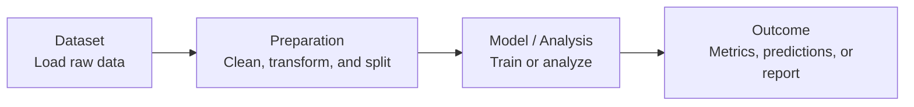

# Netflix content analysis

**Portfolio project** · An end-to-end notebook project exploring a Netflix titles dataset and predictive modeling.

## Overview

An end-to-end notebook project exploring a Netflix titles dataset and predictive modeling.

## Technology Stack

- `HTML`
- `Python`
- `Jupyter Notebook`
- `Data analysis`

## How the Repository Works

| Stage | Responsibility |
|---|---|
| **Dataset** | Load raw data |
| **Preparation** | Clean, transform, and split |
| **Model / Analysis** | Train or analyze |
| **Outcome** | Metrics, predictions, or report |

## Concepts Covered

- Project structure
- Core implementation
- Practical debugging
- Version control
- Incremental experimentation

## Repository Map

- `end-to-end-data-science-project-netflix-dataset.ipynb`
- `main`
- `model.pkl`
- `netflix_titles.csv`

## Recruiter Summary

This repository demonstrates practical implementation skills, repository organization, and an end-to-end understanding of the project workflow. It is suitable as a focused example of applied software or data work.

---

Documentation is concise and project-focused; source code was not modified.
